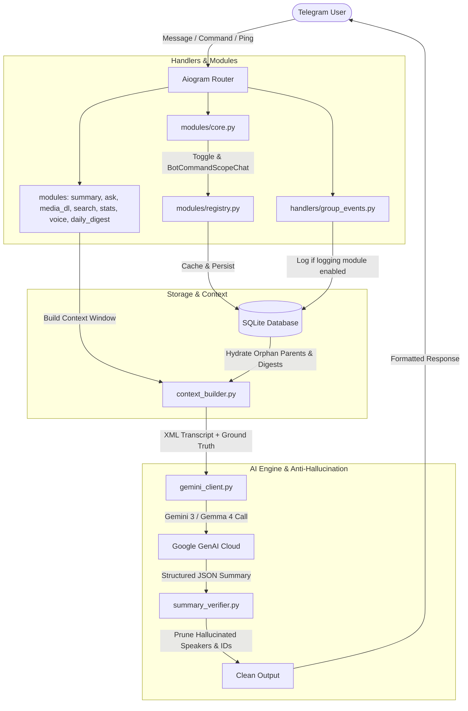

# Architecture & Design

The bot follows a layered, modular asynchronous architecture powered by **aiogram 3**, **SQLAlchemy (Async)**, and Google's **GenAI SDK**.

---

## High-Level Architecture Diagram

---

## Core Components

### 1. Ingestion Engine (`app/handlers/group_events.py`)
- Filters service messages (join/left events, pin notifications).
- Extracts rich reply metadata:
  - `reply_to_message_id`, `reply_to_author`, `reply_to_snippet`
  - Quoted text fragments (Telegram 2.0 quotes)
  - Topic/Thread IDs (`message_thread_id`)
  - Media placeholders (`[photo]`, `[voice]`, `[document: spec.pdf]`)
  - Forwarded message origins (`[forwarded: channel: TechNews]`)
- Tracks message edits (`edited_message`) by updating text and `edited_at` without resetting `is_processed`.

### 2. Context Builder (`app/services/context_builder.py`)
- **Raw-First Strategy**: If all messages within the requested time slice fit within `summary_raw_message_limit` and `summary_raw_char_limit`, the builder operates in **Pure Raw Mode**, avoiding lossy intermediate digests.
- **Orphan Hydration**: If a message in the window replies to an earlier message outside the window, the parent message is batch-fetched from the database and placed into a dedicated `[PRE-PERIOD CONTEXT]` block.
- **Namesake Disambiguation**: When different participants share the same display name, usernames (`@username`) or user IDs (`#12345`) are automatically appended.

### 3. Anti-Hallucination Verifier (`app/services/summary_verifier.py`)
- Employs a closed-world assumption:
  - `evidence_msg_ids`: Every topic and decision must cite concrete integer message IDs present in the transcript.
  - `valid_speakers`: Participants attributed to statements or decisions must exist in the chat window.
  - Fabricated claims, hallucinated participants, or phantom action items are purged before rendering.

### 4. Background Schedulers
- **Hourly Digest & Retention Loop**: Aggregates unprocessed messages into hourly digests (`ChatDigest`) in batches of 200 without holding SQLite locks during LLM calls, and prunes expired records beyond `RETENTION_DAYS`.
- **Daily Digest Tick**: Checks `ChatSettings.daily_digest_time` every 60 seconds and dispatches scheduled Europe/Kyiv daily summaries for chats with `daily_digest` enabled.

### 5. Modular Registry & Per-Chat Isolation (`app/modules/registry.py`)
- Stores per-chat feature flags in `ChatSettings` (`enabled_modules`, `daily_digest_time`, `daily_digest_last_sent`) backed by an in-memory cache.
- Syncs per-chat command menus via `BotCommandScopeChat` when admins toggle modules on `/start`, `/modules`, or `/settings`.
- Passive logging in `group_events.py` is bypassed automatically if a chat has no logging-dependent module (`summary`, `search`, `stats`, `daily_digest`) enabled.

### 6. Media Downloader (`app/services/media_downloader.py`)
- Uses `yt-dlp` and `ffmpeg` to download TikTok, Instagram, and YouTube videos either automatically or via `/dl <url>`.
- Enforces strict domain allowlists, SSRF IP/hostname checks, a 50 MB Telegram file cap, and a per-user cooldown.
