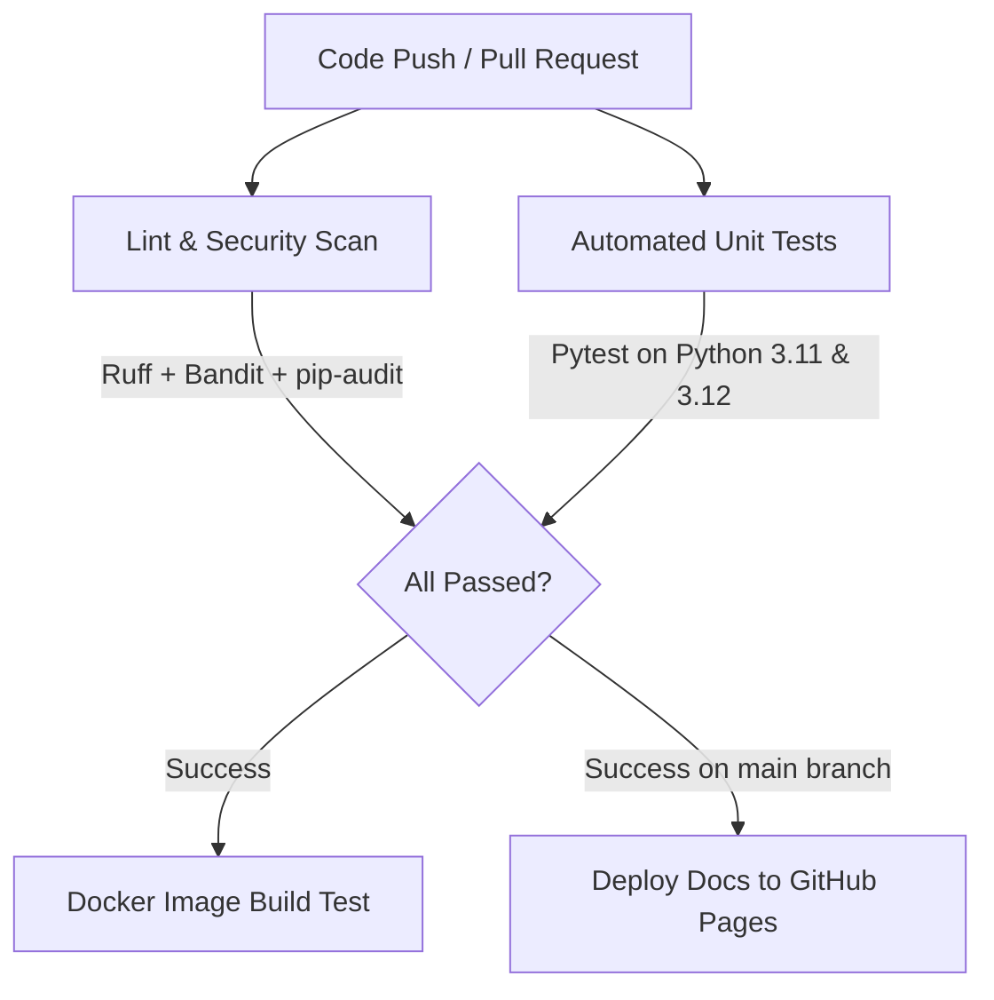

# CI/CD Pipeline & Automated Testing

The project incorporates an enterprise-grade GitHub Actions continuous integration pipeline defined in `.github/workflows/ci.yml`.

---

## Pipeline Workflow Architecture

---

## Pipeline Jobs

### 1. `lint-and-security`
- **Ruff**: Extremely fast linting and syntax validation enforcing PEP 8 and modern Python practices.
- **Bandit**: Static application security testing (SAST) scanning for unsafe SQL execution, shell injection, and secret leakage.
- **pip-audit**: Scans installed dependencies against the Python Packaging Advisory Database for known CVEs.

### 2. `test` (Automated Testing Matrix)
- Runs unit tests under **Python 3.11** and **Python 3.12**.
- Tests execute with `pytest` and generate coverage reports.
- Covers:
  - SQLite idempotent schema migrations and index creation.
  - Rich message ingestion, replies, quotes, and edited messages.
  - Context building, orphan hydration, and namesake disambiguation.
  - Anti-hallucination verification, citation generation, and JSON parsing.
  - Gemini service fallback cascades, 429 quota backoff, and 404 model TTL.
  - Command handlers, rate limits, and administrator permission checks.

### 3. `docker-build`
- Validates that the multi-stage Docker build completes cleanly without errors.
- Depends on `lint-and-security` and `test`.

### 4. `deploy-docs` (GitHub Pages)
- Builds static documentation using **Material for MkDocs**.
- Extracts live Python docstrings via `mkdocstrings`.
- Automatically deploys to GitHub Pages on every push to `main`.
